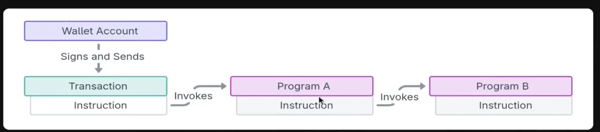
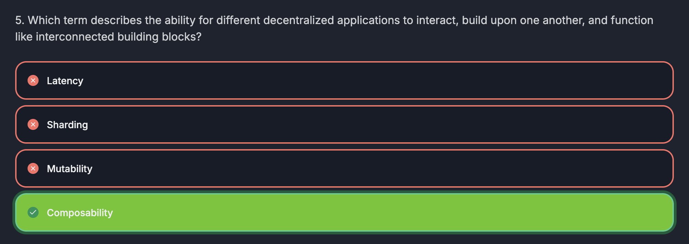

## CPI

Cross Program Invocation

- When a program calls another program

### Permissions

> Program B can use the same accounts as Program A, with their original permissions.

- The maximum amount of depth that a CPI can go [A to B (1) -> B to C (2) -> C to D (3) -> D to E (4)]

