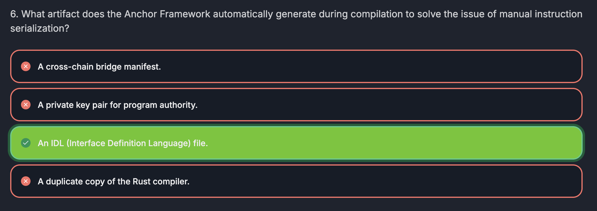

## IDL

Interface Definition Language

- The purpose of IDL is to allows to to invoke other programs without manually writing the instructions to call those programs.

- Program A invoke another program called B.
- Program A have to send the instruction (ex. increment) to Program B.
- With _Solana Native_, we need to the instruction, and also declare it in Program B.
- With _Anchor_, given that we have a code to program B, anchor framework will generate a file called **IDL**

- IDL is like an ABI, because it contains functions that can be called on a program.
- So, in Program A, we have to _import IDL_. With that, Program A will be able to call instruction that's declared on Program B.

