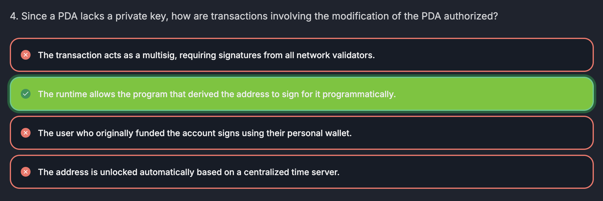

## PDA

Program Derived Address

- They DO NOT have a private key, that is associated with the public key
- They are created deterministically using `program ID` and other predefined inputs (seeds & bump)
- It's useful because we don't have to worry about key management and no one can sign, only program that owns it can modify.
- Also, it can create a hashmap like data structure.

PDA = account where SOL will be locked

### Seeds

Examples:

- user's public key
- user specified random number

### bump

- _It's a number, from 0 to 255_ to ensure that the PDA address is not a point on the Ed25519 elliptic curve.
- When we create an account that has a private key, the public key would be a point on the Ed25519 elliptic curve. When we create a PDA, that public key thats associated with this PDA is ensured to NOT BE a point on this elliptic curve.

  Example:

- 255

