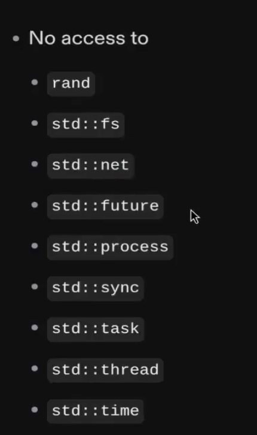

## Program Limitation

There are limitations we deploy on Solana

- NOT all Rust libraries can be used inside our programs.
  
- In Solana programs, there's a limit of computation that we can do.
- For most recent information about this, it's important to check the official documentation.
