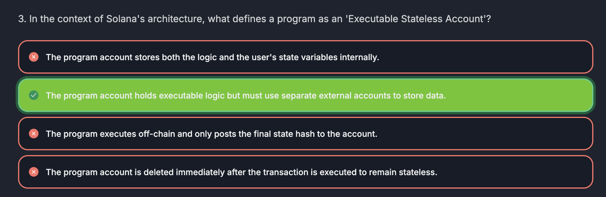

## Program

- Executable stateless **account**

We have two definitions here

- **instructions** : call to a function in a program.
- **transaction**: group of _instructions_
  > Inside a _transaction_, we can call multiple _instructions_

In a **transaction**, we have _instructions_ (ex. call counter program, initialize counter state) and _accounts_ (Alice, counter account, system program).

- In Solana, transactions could be executed in _parallel_.

